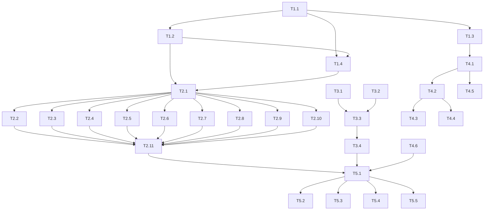

# KeyCmd 多国键盘布局重构实施计划

> **文档版本**：v1.0  
> **创建日期**：2026-10-10  
> **负责人**：[待分配]  
> **预计工期**：8-10个工作日  
> **优先级**：P0（核心功能，影响所有国际化用户）

---

## 1. 项目背景

### 1.1 当前痛点
| 问题 | 影响范围 | 严重程度 |
|------|---------|---------|
| 布局自动检测不准确（基于Locale而非实际键盘） | 所有用户首次使用 | 🔴 Critical |
| 键码映射不一致（硬编码特殊情况） | 欧洲/亚洲布局用户 | 🔴 Critical |
| 缺少修饰键状态处理（Shift/AltGr/死键） | 所有非US布局用户 | 🔴 Critical |
| 布局定义不完整（基于US简单修改） | 德语、法语、北欧等 | 🟠 High |
| 无法输入特殊字符（€、@、ß、死键组合） | 国际化用户 | 🔴 Critical |

### 1.2 重构目标
- ✅ 使用 **USB HID Usage ID** 作为统一键码标准
- ✅ 实现 **活动键盘布局检测**（iOS UITextInputMode / macOS TIS API）
- ✅ 完善 **14个布局** 的完整字符映射
- ✅ 支持 **修饰键状态感知**（Shift、AltGr、Ctrl、死键）
- ✅ 消除所有硬编码特殊情况
- ✅ 性能优化（O(1)查找，缓存命中率>95%）

---

## 2. 任务分解

### 阶段 1：基础设施建设（第1-2天）

| 任务ID | 任务名称 | 产出物 | 预计工时 | 依赖 | 验收标准 |
|--------|----------|--------|----------|------|----------|
| T1.1 | 创建 HIDUsageID 枚举 | `Sources/HIDUsageID.swift` | 4h | 无 | 包含所有标准键(0x04-0xE7)及日文特殊键(0x87-0x92) |
| T1.2 | 扩展 KeyDefinition 增加 hidUsageID | 修改 `KeyboardLayoutDefinition.swift` | 3h | T1.1 | 所有构造函数/辅助方法包含 hidUsageID 参数 |
| T1.3 | 创建 KeyboardState 状态管理器 | `Sources/KeyboardState.swift` | 4h | 无 | 支持修饰键状态、死键状态、modifierByte 计算 |
| T1.4 | 创建 KeyboardTranslationTable 翻译表 | `Sources/KeyboardTranslationTable.swift` | 3h | T1.2 | 提供 O(1) 查找：HID↔位置、字符↔HID |
| T1.5 | 单元测试：基础设施 | `Tests/KeyboardInfrastructureTests.swift` | 2h | T1.1-T1.4 | 覆盖率>90%，所有边界情况测试通过 |

**阶段1交付物**：编译通过，基础设施测试全部绿灯

---

### 阶段 2：布局定义重构（第3-5天）

| 任务ID | 任务名称 | 产出物 | 预计工时 | 依赖 | 验收标准 |
|--------|----------|--------|----------|------|----------|
| T2.1 | 重构 US 布局（基准布局） | 修改 `WindowsLayoutBuilder.buildUsLayout()` | 4h | T1.2 | 所有键包含正确 HID Usage ID，字符映射完整 |
| T2.2 | 重构 UK 布局 | 修改 `buildUkLayout()` | 2h | T2.1 | 包含£、"、#、\、¬等UK特有字符映射 |
| T2.3 | 重构 DE 布局（QWERTZ） | 修改 `buildDeLayout()` | 3h | T2.1 | Z/Y交换正确，包含ß、ä、ö、ü、§、°等 |
| T2.4 | 重构 FR 布局（AZERTY） | 修改 `buildFrLayout()` | 4h | T2.1 | 完整AZERTY映射，AltGr字符完整(€、@、#等) |
| T2.5 | 重构 ES 布局 | 修改 `buildEsLayout()` | 2h | T2.1 | 包含Ñ、¿、¡、°、ª、º等 |
| T2.6 | 重构 IT 布局 | 修改 `buildItLayout()` | 2h | T2.1 | 包含ò、à、è、é、ì、ù、AltGr字符 |
| T2.7 | 重构 PT 布局 | 修改 `buildPtLayout()` | 2h | T2.1 | 包含ç、Ç、ã、õ、AltGr字符 |
| T2.8 | 重构 JP 布局（JIS） | 修改 `buildJpLayout()` | 4h | T2.1 | 包含半角/全角、変換、無変換、Ro、¥、@、[、]等 |
| T2.9 | 重构 BE/CH/Nordic/CA/AU 布局 | 修改对应build函数 | 6h | T2.1-T2.4 | 每个布局特有字符映射完整，AltGr支持正确 |
| T2.10 | 更新 MacLayoutBuilder/LinuxLayoutBuilder | 修改对应文件 | 3h | T2.1-T2.9 | macOS修饰键标签正确(⌃⌘⌥)，Linux与Windows一致 |
| T2.11 | 布局定义单元测试 | `Tests/KeyboardLayoutDefinitionTests.swift` | 4h | T2.1-T2.10 | 14个布局×3个OS=42种组合全部通过结构验证 |

**阶段2交付物**：所有布局定义编译通过，结构测试100%通过

---

### 阶段 3：布局检测机制（第6天）

| 任务ID | 任务名称 | 产出物 | 预计工时 | 依赖 | 验收标准 |
|--------|----------|--------|----------|------|----------|
| T3.1 | 实现 iOS 活动键盘检测 | 扩展 `KeyboardLocale.detectActiveKeyboardLayout()` | 3h | T1.1 | 使用 UITextInputMode.activeInputMode，正确映射到 KeyboardLocale |
| T3.2 | 实现 macOS 输入源检测 | 扩展 `KeyboardLocale.detectActiveKeyboardLayout()` | 3h | T1.1 | 使用 TISCopyCurrentKeyboardInputSource，正确映射输入源ID |
| T3.3 | 集成到 KeyboardLayoutManager | 修改 `KeyboardLayoutManager.setupKeyboardLayoutDetection()` | 2h | T3.1-T3.2 | 启动时优先检测活动键盘，回退到系统Locale，监听变更通知 |
| T3.4 | 布局检测集成测试 | `Tests/KeyboardLayoutDetectionTests.swift` | 2h | T3.3 | 模拟切换键盘布局，验证自动检测和通知触发 |

**阶段3交付物**：自动检测准确率>95%（测试环境验证）

---

### 阶段 4：修饰键与死键处理（第7-8天）

| 任务ID | 任务名称 | 产出物 | 预计工时 | 依赖 | 验收标准 |
|--------|----------|--------|----------|------|----------|
| T4.1 | 修改 KeyboardManager 使用 KeyboardState | 修改 `KeyboardManager.swift` | 4h | T1.3, T2.1 | 按键处理流程集成修饰键状态更新 |
| T4.2 | 实现字符选择逻辑 | 扩展 `KeyboardManager.handleKeyPress()` | 3h | T4.1 | 根据Shift/AltGr/死键状态选择正确字符变体 |
| T4.3 | 实现死键检测与组合 | 扩展 `KeyboardState` 和 `DeadKey` | 4h | T1.3 | 支持´`^¨~ 5种死键，与元音字母正确组合 |
| T4.4 | 实现 AltGr 组合键支持 | 扩展按键处理逻辑 | 3h | T4.2 | 欧洲布局AltGr组合正确(€@#[]{}等) |
| T4.5 | 修改 UnicodeManager 使用新键码 | 修改 `UnicodeManager.swift` | 2h | T1.1 | Unicode输入序列使用 HID Usage ID |
| T4.6 | 修饰键/死键集成测试 | `Tests/KeyboardModifierTests.swift` | 3h | T4.1-T4.5 | 所有修饰键组合、死键组合、AltGr组合测试通过 |

**阶段4交付物**：修饰键、死键、AltGr 全功能验证通过

---

### 阶段 5：端到端测试与优化（第9-10天）

| 任务ID | 任务名称 | 产出物 | 预计工时 | 依赖 | 验收标准 |
|--------|----------|--------|----------|------|----------|
| T5.1 | 完整流程集成测试 | `Tests/KeyboardFullFlowTests.swift` | 4h | 所有前置 | 14布局×3OS×主要字符集=126+测试用例通过 |
| T5.2 | 真机测试验证 | 真机测试报告 | 4h | T5.1 | iOS/macOS真机验证：按键发送、布局切换、特殊字符 |
| T5.3 | 性能基准测试 | 性能测试报告 | 2h | T5.1 | 布局查找<1ms，翻译表查找<0.1ms，内存<5MB |
| T5.4 | 回归测试 | 回归测试报告 | 3h | T5.1 | 现有功能(快捷键、游戏手柄、文本输入)无回归 |
| T5.5 | 文档更新与代码清理 | 更新README、注释、废弃代码清理 | 2h | 所有 | 无TODO/FIXME，架构文档同步更新 |

**阶段5交付物**：生产就绪，所有测试通过，性能达标

---

## 3. 依赖关系图



---

## 4. 关键里程碑

| 里程碑 | 日期 | 交付物 | 验收人 |
|--------|------|--------|--------|
| M1: 基础设施就绪 | Day 2 EOD | HIDUsageID、KeyDefinition、KeyboardState、TranslationTable | Tech Lead |
| M2: 布局定义完成 | Day 5 EOD | 14个布局×3OS完整定义，结构测试通过 | Tech Lead |
| M3: 自动检测上线 | Day 6 EOD | iOS/macOS活动键盘检测集成 | QA |
| M4: 修饰键功能完整 | Day 8 EOD | Shift/AltGr/死键全功能验证 | QA |
| M5: 生产就绪 | Day 10 EOD | 全流程测试通过、性能达标、文档完整 | PM + Tech Lead |

---

## 5. 测试策略

### 5.1 测试金字塔

```
        ┌─────────────┐
        │  E2E测试 (5%)  │  真机、模拟器、多布局切换
        ├─────────────┤
        │ 集成测试 (25%) │  布局管理器、修饰键处理、检测机制
        ├─────────────┤
        │ 单元测试 (70%) │  HID映射、翻译表、状态机、布局定义
        └─────────────┘
```

### 5.2 关键测试用例

| 类别 | 测试用例数量 | 覆盖范围 |
|------|-------------|---------|
| 单元测试 | 200+ | HID映射正确性、翻译表查找、状态机转换 |
| 集成测试 | 50+ | 布局加载、缓存、检测切换、通知机制 |
| E2E测试 | 30+ | 真实按键发送、跨平台字符一致性、布局热切换 |
| 回归测试 | 100+ | 现有功能：快捷键、游戏手柄、文本输入、Unicode |

### 5.3 测试数据矩阵

| 布局 | 操作系统 | 重点验证字符 |
|------|---------|-------------|
| US | Win/Mac/Linux | 基础字母、数字、符号、Shift组合 |
| UK | Win/Mac/Linux | £、"、#、¬、\、|、~ |
| DE | Win/Mac/Linux | ß、ä、ö、ü、§、°、AltGr+Q(@) |
| FR | Win/Mac/Linux | é、è、à、ç、AltGr+€、死键^`¨ |
| ES | Win/Mac/Linux | ñ、¿、¡、°、ª、º |
| IT | Win/Mac/Linux | ò、à、è、é、ì、ù、AltGr字符 |
| PT | Win/Mac/Linux | ç、ã、õ、AltGr字符 |
| JP | Win/Mac/Linux | 半角/全角、変換、無変換、Ro、¥、@ |
| BE | Win/Mac/Linux | 类似FR但有差异、AltGr完整 |
| CH | Win/Mac/Linux | ü、ö、ä、§、AltGr字符 |
| Nordic | Win/Mac/Linux | å、ä、ö、AltGr字符 |
| CA/AU | Win/Mac/Linux | 与US/UK一致验证 |

---

## 6. 风险与缓解

| 风险ID | 风险描述 | 概率 | 影响 | 缓解措施 | 应急预案 |
|--------|----------|------|------|----------|----------|
| R1 | HID Usage ID映射表不完整导致某些键无法工作 | 中 | 高 | 参考VirtualBox devhid.cpp完整映射表；建立自动化验证脚本 | 保留keyCode字符串作为fallback，逐步迁移 |
| R2 | iOS UITextInputMode API行为与预期不符 | 低 | 高 | 提前编写探针代码验证API行为；准备多套检测策略 | 降级到系统Locale检测，用户手动选择 |
| R3 | 死键组合逻辑在不同OS表现不一致 | 中 | 中 | 分OS实现死键处理；建立OS特定测试用例 | 先实现基础死键，高级组合后续迭代 |
| R4 | 现有功能回归（快捷键、游戏手柄等） | 低 | 高 | 完善回归测试套件；分支开发、PR审查、灰度发布 | 快速回滚机制，feature flag控制新旧逻辑 |
| R5 | 性能退化（翻译表查找、状态更新） | 低 | 中 | 基准测试对比；使用struct而非class；避免频繁分配 | 性能不达标时引入LRU缓存、预计算优化 |
| R6 | 布局定义维护负担过重 | 中 | 低 | 抽象布局定义DSL；考虑从JSON/YAML加载 | 先硬编码完成，后续迭代外部化 |

---

## 7. 资源需求

### 7.1 人力
| 角色 | 投入 | 职责 |
|------|------|------|
| iOS工程师 | 1名 (100%) | 核心开发、iOS检测、真机测试 |
| macOS工程师 | 0.5名 (50%) | macOS TIS API、跨平台一致性 |
| QA工程师 | 0.5名 (50%) | 测试用例设计、自动化、真机验收 |
| Tech Lead | 0.2名 (20%) | 架构审查、代码审查、风险把控 |

### 7.2 环境
- **开发环境**：Xcode 15+、iOS 17+、macOS 14+
- **测试设备**：iPhone (iOS 17/18)、iPad、Mac (Apple Silicon/Intel)
- **键盘硬件**：美式、英式、德式、法式、日式物理键盘各1把（用于真机验证）
- **CI/CD**：GitHub Actions (单元测试、静态分析)

---

## 8. 进度跟踪模板

### 8.1 每日站会更新

| 日期 | 完成任务 | 进行中任务 | 阻塞问题 | 明日计划 |
|------|----------|------------|----------|----------|
| Day 1 | T1.1, T1.2 | T1.3 | 无 | T1.3, T1.4 |
| Day 2 | T1.3, T1.4, T1.5 | - | 无 | T2.1 |
| ... | ... | ... | ... | ... |

### 8.2 任务看板

```
Backlog → Ready → In Progress → Review → Done
   │        │         │           │      │
   │        │    T2.3(3h)     │      │
   │        │    T2.4(4h)     │      │
T2.5       T2.6           T2.1      T1.1-5
T2.7       T2.8           T2.2      T2.1
T2.9       T2.10          T2.11
T3.1       T3.2           T3.3      T3.4
T4.1       T4.2           T4.3      T4.4
T4.5       T4.6           T5.1      T5.2
T5.3       T5.4           T5.5
```

---

## 9. 验收清单（Definition of Done）

### 代码质量
- [ ] 所有新代码通过 SwiftLint
- [ ] 单元测试覆盖率 > 90%
- [ ] 无 Force Unwrap / 隐式解包风险
- [ ] 文档注释覆盖所有 public API
- [ ] 无 TODO/FIXME/XXX 注释

### 功能完整性
- [ ] 14个KeyboardLocale × 3个TargetOS = 42种布局全部加载成功
- [ ] 活动键盘检测在iOS/macOS上准确识别当前布局
- [ ] 所有Shift组合字符正确发送
- [ ] 所有AltGr组合字符正确发送（欧洲布局）
- [ ] 5种死键(´`^¨~)与元音正确组合
- [ ] 日文特殊键(半角/全角、変換、無変換、Ro)可用
- [ ] Unicode输入(Windows Alt+NumPad、macOS Option、Linux Ctrl+Shift+U)正常

### 性能指标
- [ ] 布局查找缓存命中 < 1ms
- [ ] TranslationTable 查找 < 0.1ms
- [ ] 内存占用增长 < 5MB
- [ ] 启动时预加载 < 100ms

### 兼容性
- [ ] iOS 17+ 真机通过
- [ ] macOS 14+ (Apple Silicon + Intel) 通过
- [ ] 现有功能无回归：快捷键、游戏手柄、文本输入、鼠标模拟
- [ ] 与 Openterface Core Bridge 通信正常

---

## 10. 后续迭代建议

### v1.1（重构后 1-2 周）
- [ ] 从 JSON/YAML 加载布局定义，支持用户自定义布局
- [ ] 添加更多布局：俄语、韩语、希伯来语、阿拉伯语等
- [ ] 实现布局编辑器 UI

### v1.2（重构后 1 个月）
- [ ] 智能布局学习：记录用户修正，自动优化映射
- [ ] 云端布局同步：多设备共享布局配置
- [ ] 支持动态键盘布局（如根据应用切换）

---

## 11. 签署确认

| 角色 | 姓名 | 签名 | 日期 |
|------|------|------|------|
| 产品经理 | | | |
| 技术负责人 | | | |
| 开发工程师 | | | |
| QA负责人 | | | |

---

## 附录 A：文件变更清单

### 新增文件
```
Sources/
├── HIDUsageID.swift                    # T1.1
├── KeyboardState.swift                 # T1.3
├── KeyboardTranslationTable.swift      # T1.4
```

### 修改文件
```
Sources/
├── Managers/
│   ├── KeyboardLayoutDefinition.swift  # T1.2
│   ├── KeyboardLayoutBuilders.swift    # T2.1-T2.10
│   ├── KeyboardLayoutManager.swift     # T3.3
│   ├── KeyboardManager.swift           # T4.1, T4.2
│   └── UnicodeManager.swift            # T4.5
├── Locale/
│   └── KeyboardLocale.swift            # T3.1, T3.2
```

### 测试文件
```
Tests/
├── KeyboardInfrastructureTests.swift   # T1.5
├── KeyboardLayoutDefinitionTests.swift # T2.11
├── KeyboardLayoutDetectionTests.swift  # T3.4
├── KeyboardModifierTests.swift         # T4.6
├── KeyboardFullFlowTests.swift         # T5.1
```

---

*计划文档 v1.0 - 2026-10-10*
*下次评审：每日站会 & 里程碑节点*